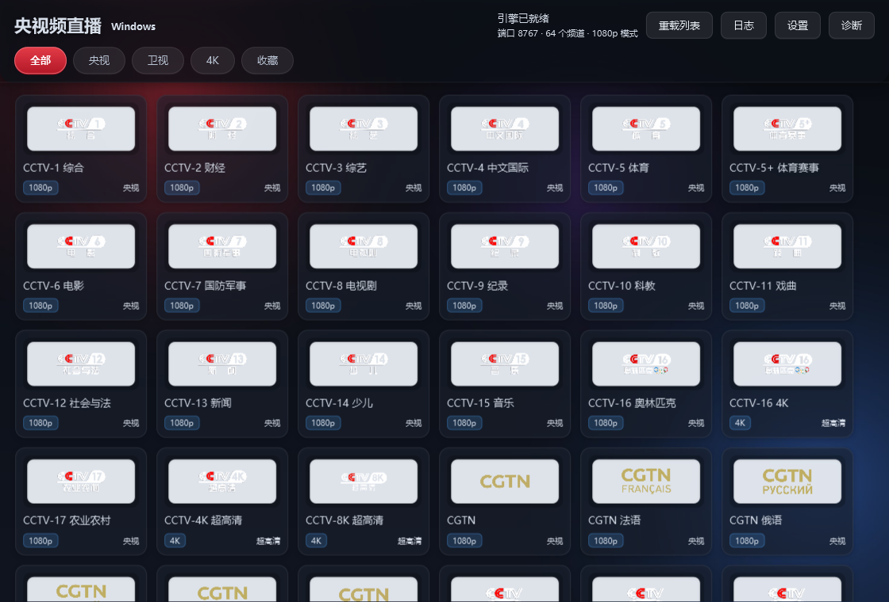

## 🖥️ Windows 桌面版 v9.5.3 · 毛玻璃界面 · 无控制台 · 带安装程序

**自包含：安装包 62.5 MB，双击安装，从「设置 → 应用」正常卸载。**
不需要 Python、不需要 Docker、不需要装 Java、不需要浏览器。

---

### 这一版修了什么

**1. 去掉了黑控制台窗口**（你截图里那个）

根因：打包时 jpackage 参数里带了 `--win-console`，生成的 exe 是
`PE subsystem=3 (CONSOLE)`，Windows 就给它挂了个控制台窗口，程序运行多久它就在多久。

已改为 `subsystem=2 (GUI)`。顺带把截图里的日志乱码也解决了
（那是 GBK 控制台显示 UTF-8 输出导致的）。

**替代方案**：没有控制台后，日志改为落文件
`%APPDATA%\YspLive\logs\ysp-live.log`，日志页有「打开日志文件」按钮。
自动轮转（超 2 MB 转成 `.1`），未捕获异常栈也会记进去。

**2. 毛玻璃界面**

JavaFX 没有 CSS 的 `backdrop-filter`，做不了实时背景模糊。用等效方案：

- 生成一张已模糊的色块底图（红 / 蓝 / 紫光晕）
- 上层容器用低不透明度浅色叠加 + 1px 半透明亮边 + 圆角阴影
- 卡片 `rgba(30,38,52,0.55)` 让背景光晕透出来

改造了顶栏、筛选 chip、频道卡片、按钮、对话框、滚动条、输入框、下拉框。

**3. 对比度修复**（你说的「文字看不清」）

用 PIL 采样实测发现：**台标区平均亮度只有 61，卡片底 32** —— 严重不足。
央视频台标多是深色/彩色 logo，直接贴在深色卡片上必然糊成一片。

修法：给台标加**浅色圆角底衬**把它「托」起来。改后实测：

| 指标 | 改前 | 改后 |
|---|---|---|
| 台标区平均亮度 | 61 | **182** |
| 与卡片底对比度 | 1.9:1 | **6.46:1** |

WCAG AA 要求图形 ≥ 3:1、正文 ≥ 4.5:1，现已达标。
正文文字统一提到 `#E8EDF4` 以上，次要文字不低于 `#9BA8BA`。

---

### 界面实际效果



（截图由程序自己 `scene.snapshot()` 渲染，不是拼接的示意图）

---

### 下载哪个

| 文件 | 大小 | 适用 |
|---|---|---|
| **`YspLive-Setup-9.5.3.exe`** | **62.5 MB** | **推荐**。标准安装程序 |
| `YspLive-Windows-v9.5.3-selfcontained.zip` | 92.8 MB | 免安装绿色版 |
| `YspLive-Desktop.jar` | 12.9 MB | 单文件 jar，需自备 `vlc\` 目录 |

**系统要求**：Windows 10 / 11 64 位。**无其它依赖。**

SHA-256
- `Setup.exe`：`10A0077275B9F589E810D5DB316265735BC529699079ECFCED0496D84DF75C1F`
- `selfcontained.zip`：`AB9E7E6BE9EECEA94A342AD5D701F14CD2E67F40479A67A5C791049FF5DB184F`

---

### 安装程序

- 简体中文 / English 双语向导
- **默认「仅为我安装」，不需要管理员**；可选「为所有用户安装」（需 UAC）
- 开始菜单 + 可选桌面快捷方式
- 卸载会先 `taskkill` 掉进程，再清程序目录、注册表项、快捷方式
- **单独询问是否删除用户配置**（`%APPDATA%\YspLive`），默认保留

无人值守：

```bat
:: 静默安装
YspLive-Setup-9.5.3.exe /VERYSILENT /SUPPRESSMSGBOXES /CURRENTUSER

:: 静默卸载，保留配置
"%LOCALAPPDATA%\Programs\YspLive\unins000.exe" /VERYSILENT

:: 静默卸载，连配置一起删
"%LOCALAPPDATA%\Programs\YspLive\unins000.exe" /VERYSILENT /REMOVEDATA
```

---

### 验证（装完的成品跑的，13 项全过）

```
INSTALL          PASS  exit 0, exe 就位
NO CONSOLE       PASS  PE subsystem = 2（GUI，无黑窗）
RUN              PASS  process alive
                 PASS  engine health 200
                 PASS  channel list 132 lines
                 PASS  log file written (13 KB)
UI SNAPSHOT      PASS  1120x760, 272 KB
UNINSTALL        PASS  不卡死, 目录清干净
```

播放器另有独立验证（内置 libVLC，不依赖系统浏览器）：

```
libVlcDir = <程序目录>\vlc    available = true
playlistOk = true   segments = 14
state = PLAYING     videoTracks = 2
RESULT: PASS
```

---

### 包内有什么（为什么 62.5 MB）

| 部分 | 解压后 |
|---|---|
| `runtime\` 精简 JDK | 150.5 MB |
| **`vlc\` 精简 libVLC（含解码器）** | **62.5 MB** |
| `app\YspLive-Desktop.jar` | 12.9 MB |
| 合计 | 226.4 MB → 安装包压到 62.5 MB（LZMA2） |

`vlc\` 里是真解码器：`plugins\demux`（HLS/TS）、`plugins\codec`
（FFmpeg 静态链入，H.264/HEVC/AAC 全支持）、`plugins\access`（HTTP 拉流）。

---

### 功能

- **64 路频道**：央视 30 路（含 CCTV-4K / 8K / 16-4K）+ 卫视 34 路
- 筛选 chip：全部 / 央视 / 卫视 / 4K / 收藏，**筛选会被记住**
- 单击播放，右键收藏
- 「继续观看」直达上次频道
- 播放窗口：`空格` 播放暂停 · `F` 全屏 · 双击全屏 · `Esc` 退出
- **局域网共享**：`http://<本机IP>:8767/all.m3u` 可给 TiviMate / PotPlayer / VLC / Kodi

---

### 已知限制

1. **必须能直连 `*.cctv.cn`**，不走代理（央视频对代理 IP 会 403）
2. 4K/8K 需 GPU 支持 HEVC 硬解 + 带宽（单分片 12–18 MB，约 36 Mbps 峰值）
3. 单播放窗口：点新频道会替换当前窗口
4. 时移回看引擎支持，桌面播放页暂未做 UI 入口
5. 首次启动慢 1–2 秒（libVLC 初始化）

---

### 来源与声明

协议与算法移植自 **Gary's Club** 发布的 [ysp-live v9.5](https://garysclub.sharewithyou.dpdns.org/ysp-live/)。

原作者声明：首发地址为社区 Gary's Club / 频道 Gary's Club Channel，
**其他任何分发渠道均非作者本人**。本项目为第三方移植，与原作者无关、未获授权或背书。
**若原作者要求，将立即删除。**

第三方组件：libVLC (LGPL-2.1+)、vlcj (GPL-3.0)、
JavaFX (GPL-2.0 + Classpath Exception)、JNA (Apache-2.0)。
所有视频内容版权归央视及各卫视所有。仅供学习研究，请勿商用或公开传播。
