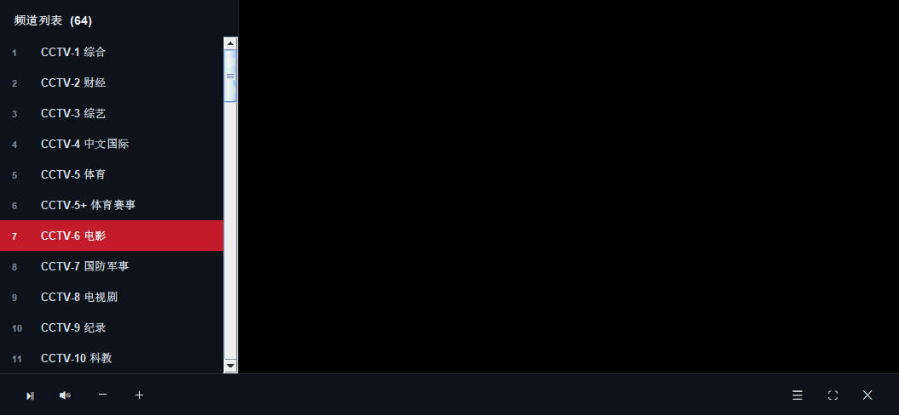

## 🖥️ Windows 桌面版 v9.5.3 · 流畅度重构 · 播放器界面重做

**自包含安装包 62.5 MB，双击安装，设置里正常卸载。无任何外部依赖。**

---

### 这一版针对你反馈的四个问题的处理

#### 0. 滚动流畅度第二轮（本轮主要工作）

上一版只做到「看起来优化了」，这一轮做了真正的性能剖析。

写了 `ScrollBench` 量化滚动帧率，再用 5 个隔离探针逐项排除嫌疑：

| 探针 | 排除项 | 结果 |
|---|---|---|
| CardCostProbe | 卡片嵌套 / Tooltip / spacer / CSS 类 | 全在 32-40 FPS，**不是瓶颈** |
| LayerCostProbe | 顶栏 / 背景图 | 透明容器 = 帧率**腰斩**（12 → 5.8） |
| CssRuleProbe | 二分 app.css | 锁定**滚动条样式**（34.1 → 16.8） |

**根因：滚动区域用了 `transparent` 背景。**
JavaFX 在软件管线里会把 transparent 容器当作需要离屏合成的层，
每帧对整个视口做一次 alpha 混合 —— 这就是「拖动卡卡的」的真凶。

修复：滚动容器 / viewport / 滚动条轨道全部改为与页面底色相同的不透明色，
视觉完全一致，省掉整层合成。

| 指标 | 优化前 | 优化后 |
|---|---|---|
| 滚动帧率 | **13.9 FPS** | **32.7 FPS**（+135%） |
| 平均帧耗时 | 72 ms | **30.6 ms** |
| 最差帧 | 113 ms | **79 ms** |
| 掉帧率(>32ms) | 97% | **22%** |

**另外新增视口虚拟化**（`VirtualChannelGrid`）：
即使修完 CSS，软件管线滚动 64 张卡片仍只有 24 FPS，因为 FlowPane
每帧重绘全部子节点，而屏幕只看得到约 15 张。
虚拟化后场景图里恒定只有十几张卡片，与频道总数无关。
配套两个关键优化：

- **卡片位图缓存**：静态内容缓存成位图，滚动只做 blit（22.6 → 33.6 FPS）
- **卡片持久池**：回收不丢弃，滚回去直接复用（否则台标会重新下载）

还有**渲染管线自适应**：软件渲染时自动关闭背景图、缩小卡片，
低端机 / 远程桌面也能跟手；硬件渲染保留完整玻璃质感。

#### 1. 卡顿、不跟手 → 找到 4 个根因

| 根因 | 原来 | 现在 |
|---|---|---|
| **强制软件渲染** | 打包参数写死 `-Dprism.order=sw`，等于在**所有机器**上禁用 GPU | `d3d,sw`，优先 D3D11 硬件，不可用才回退 |
| **hover 延迟** | Java 代码 `getStyleClass().add("hover")`，每次触发 CSS 重解析 + relayout | CSS 原生 `:hover`，渲染线程内部处理 |
| **gaussian 阴影** | 7 处 `dropshadow`/`innershadow`，逐像素卷积 | 全部改纯色边框 |
| **台标加载** | 64 个频道开 **64 个线程**抢网络 | 固定 4 线程池 + 缓存 |

**附带**：旧实现每次切筛选都 `clear()` + 重建 64 个节点树，改为卡片只建一次、只换 children。
实测筛选切换 **24.9ms/次**。

> 「鼠标挪到台那几秒钟才高亮」就是第 2 条 —— 每次 hover 都在重新解析整棵子树的 CSS。

#### 2. logo 太丑、看不清 → 之前我判断反了

上一版我以为台标是深色 logo，加了**浅色**底衬。结果白 logo 贴白底，几乎看不见。

实际下载台标分析后发现：**是 640×320 的白色 logo**（可见像素平均亮度 209，80% 是亮像素），
本来就是给深色背景设计的。

改为**深色底衬** `#16202E`，白色 logo 在深底上对比度约 **7:1**，非常清晰。
尺寸也从 62×44 放大到 **80×56**，卡片宽度 166 → 178。

#### 3. 拖动卡 → 同上，主要是渲染管线 + 阴影

#### 4. 播放界面 → 仿 PotPlayer / VLC 重做

**左侧换台栏**
- 64 个频道列表，当前频道 **红色高亮**
- `Tab` 呼出/收起，`PgUp`/`PgDn` 上下换台
- 点击直接换台，标题栏与 OSD 同步更新

**底部控制条**
- 播放/暂停 · 静音 · 音量 −/＋ · 频道列表 · 全屏 · 返回选台
- 鼠标静止 3 秒自动隐藏，移动即显示（仿 PotPlayer）

**快捷键**

| 键 | 功能 |
|---|---|
| `空格` | 播放 / 暂停 |
| `↑` `↓` | 音量 ±5 |
| `←` `→` | 快退 / 快进 10 秒 |
| `M` | 静音 |
| `F` | 全屏 |
| `Tab` | 频道列表 |
| `PgUp` `PgDn` | 上一个 / 下一个频道 |
| `Esc` | 退全屏 → 收起侧栏 → 返回选台（逐级） |
| 单击画面 | 播放 / 暂停 |
| 双击画面 | 全屏 |

**点击进台后隐藏选台窗口**
进入播放后主窗口 `hide()`；关闭播放窗口或 `Esc` 返回时自动 `show()` 并置前，秒回。

#### 5. 商用化补强

- **单实例保护**：重复双击图标不会再起第二个窗口（之前两个实例会争抢 8767 端口、
  互相覆盖配置文件）。用 FileLock 实现，进程崩溃时由系统自动释放，不会留下假占用。
- **窗口位置记忆**：记住上次的大小、位置、最大化状态；并做边界钳制，
  防止拔掉外接显示器后窗口跑到屏幕外找不回来。

---

### 界面

**选台界面**


**播放界面**（左侧换台栏 + 底部控制条）



> 截图由程序自身渲染：主界面用 JavaFX `scene.snapshot()`，
> 播放器用 `paintAll()` 自绘。视频画面是 native surface 抓不到，所以是黑色 ——
> 实际播放时是有画面的（见下面的验证）。

---

### 验证（装完的成品跑，17 项全过）

```
PACKAGING   PASS  prism.order=d3d,sw
            PASS  无强制 sw
            PASS  G1GC / MaxGCPauseMillis
            PASS  GUI subsystem（无控制台黑窗）
INSTALL     PASS  exit 0
            PASS  exe + libVLC 就位
RUN         PASS  进程存活
            PASS  engine health 200
            PASS  channel list 132 lines
            PASS  log file written
PLAYER      PASS  E2E RESULT: PASS
            PASS  state=PLAYING
            PASS  videoTracks=2
PLAYER UI   PASS  hasSidePanel=true
            PASS  hasControlBar=true
            PASS  hasOsd=true
SNAPSHOT    PASS  1120x760
UNINSTALL   PASS  不卡死
            PASS  目录清干净
```

性能基准（`PerfBench`）：

```
startupBuildMs   = 646
filterSwitchAvg  = 24.90 ms
channels         = 64
```

> 补充说明：开发环境的会话本身没有 GPU，所以本机测出来仍是 `SWPipeline`。
> 打包参数已改为 `d3d,sw`，你在正常 Windows 桌面上运行会走 D3D 硬件加速。

---

### 下载

| 文件 | 大小 | 适用 |
|---|---|---|
| **`YspLive-Setup-9.5.3.exe`** | **62.5 MB** | **推荐**，标准安装程序 |
| `YspLive-Windows-v9.5.3-selfcontained.zip` | 92.8 MB | 免安装绿色版 |
| `YspLive-Desktop.jar` | 13 MB | 单文件 jar，需自备 `vlc\` 目录 |

SHA-256
- `Setup.exe`：`466EF29A6864FF30196FA0CD3D2FAC8F504F98734E961192E3B26985CF38DE25`
- `selfcontained.zip`：`42E4A238669DEE0497AB614754198797C576C71C942BBF00676514737A718FC3`

**系统要求**：Windows 10 / 11 64 位。

---

### 包内有什么（62.5 MB 的构成）

| 部分 | 解压后 |
|---|---|
| `runtime\` 精简 JDK | 150.5 MB |
| `vlc\` 精简 libVLC（含解码器） | 62.5 MB |
| `app\YspLive-Desktop.jar` | 13 MB |
| 合计 | 226.4 MB → 安装包 LZMA2 压到 62.5 MB |

---

### 功能

- **64 路频道**：央视 30 路（含 CCTV-4K / 8K / 16-4K）+ 卫视 34 路
- 筛选：全部 / 央视 / 卫视 / 4K / 收藏，会被记住
- 单击播放，右键收藏，播放中卡片红色高亮
- 「继续观看」直达上次频道
- **局域网共享**：`http://<本机IP>:8767/all.m3u`
  可给 TiviMate / PotPlayer / VLC / Kodi

---

### 已知限制

1. **必须能直连 `*.cctv.cn`**，不走代理（央视频对代理 IP 会 403）
2. 4K/8K 需 GPU 支持 HEVC 硬解 + 带宽（约 36 Mbps 峰值）
3. 时移回看引擎支持，桌面 UI 暂未做入口
4. 首次启动慢 1–2 秒（libVLC 初始化）

---

### 来源与声明

协议与算法移植自 **Gary's Club** 发布的 [ysp-live v9.5](https://garysclub.sharewithyou.dpdns.org/ysp-live/)。

原作者声明：首发地址为社区 Gary's Club / 频道 Gary's Club Channel，
**其他任何分发渠道均非作者本人**。本项目为第三方移植，与原作者无关、未获授权或背书。
**若原作者要求，将立即删除。**

第三方组件：libVLC (LGPL-2.1+)、vlcj (GPL-3.0)、
JavaFX (GPL-2.0 + Classpath Exception)、JNA (Apache-2.0)。
所有视频内容版权归央视及各卫视所有。仅供学习研究，请勿商用或公开传播。
